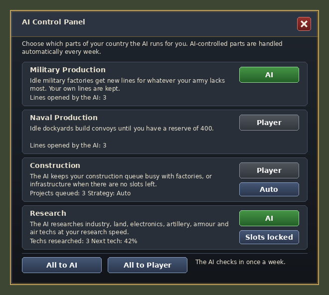

# AI Control Panel — a Hearts of Iron IV mod (1.19.x)

Adds a panel that lets you hand parts of your country over to the AI while you
keep playing the rest yourself. Each part has its own switch between **Player**
and **AI**:

| Module | What the AI does while it's in control |
|---|---|
| **Military Production** | Every week, idle military factories get new production lines for whatever your army is shortest of: infantry equipment, support equipment, artillery, anti-tank, anti-air or trucks. It always uses the best infantry model you have. Lines you set up yourself are left alone. |
| **Naval Production** | Idle dockyards build convoys until you have a reserve of 400. |
| **Construction** | Keeps the construction queue busy: one project for every 15 free civilian factories, plus a spare. It picks core states with free slots and builds infrastructure once no factory slots are left. You choose the strategy: **Auto** (civilian factories until 1938 or war, then 3 military for every civilian), **Civilian** or **Military**. |
| **Research** | Researches technologies at your research speed (slots × research bonus), following a priority rotation: industry, land, electronics, artillery, then armour and air. It doesn't research a tech before its historical year. |



*(Mockup made from the mod's own textures and layout. In game, text uses HoI4's fonts.)*

## Opening the panel

* Click the **AI Control** button in the bottom-left corner of the screen. You
  can drag it anywhere. A green light on it means at least one module is
  AI-controlled.
* Or use the **AI Control → Open the AI Control Panel** decision. It's a
  fallback in case another UI mod covers the button.

## Installation

1. Copy the `ai_control_panel` folder **and** the `ai_control_panel.mod` file into
   `Documents/Paradox Interactive/Hearts of Iron IV/mod/`.
2. Enable **AI Control Panel** in the launcher's playset.

The mod doesn't overwrite any vanilla files, so it works with most other mods.
It changes the checksum, so Ironman achievements are disabled.

## How it works (and its limits)

HoI4's scripting language has no command that gives one part of a human
player's country to the game's built-in AI. This mod therefore runs its own
AI logic in script once a week (`on_weekly`), using the effects the engine
provides:

* **Production** uses `add_equipment_production`. Tanks, planes and ships are
  built from designs, and script can't choose a design. So the production AI
  only handles land equipment that doesn't need the designer, plus convoys.
  Artillery, anti-tank and anti-air lines use the first model.
* **Construction** uses `add_building_construction`. Script can't read the
  queue, so the mod estimates how much work it has queued and lowers the
  estimate each week by what your free civilian factories can build. If you
  cancel the AI's projects by hand, it will simply queue new ones.
* **Research**: script can't put a tech into a research slot. The AI earns
  research progress each week based on your slots and research speed, then
  completes the next tech with `set_technology`. A popup tells you each time.
  The **Slots locked** option is on by default. It adds an "AI Research"
  national modifier that cancels your research speed exactly, so you don't get
  research twice. Set it to **Slots free** to keep researching yourself as
  well (much faster than normal). The AI doesn't research doctrines or naval
  techs.

## Customising

* **Research priorities:** edit the lists in `tools/gen_research.py`, then run
  `python3 tools/gen_research.py` to regenerate
  `common/scripted_effects/ai_ctrl_research_lists.txt`. Techs that don't exist
  in your game (e.g. from missing DLC or other mods) are skipped. Each skipped
  tech may write one line to `error.log`.
* **Production weights / reserves:**
  `common/scripted_effects/ai_ctrl_production_effects.txt`.
* **Construction rules:**
  `common/scripted_effects/ai_ctrl_construction_effects.txt`.
* **Textures:** `python3 tools/gen_textures.py` (needs Pillow) regenerates
  every `.dds` and the thumbnail.
* `python3 tools/check_mod.py` runs offline checks: brace balance, undefined
  effects, missing localisation keys and sprites.

## Multiplayer

Every setting is stored per country, and all clicks go through scripted GUI
effects. Each player controls only their own country's AI settings, and
everything stays in sync.

## Project layout

```
ai_control_panel.mod                      launcher descriptor (goes next to the folder)
ai_control_panel/
  descriptor.mod, thumbnail.png
  common/scripted_guis/                   GUI logic (buttons, visibility)
  common/scripted_effects/                the AI modules
  common/scripted_triggers/               state-selection triggers
  common/scripted_localisation/           dynamic button text
  common/on_actions/                      weekly tick
  common/dynamic_modifiers/               "AI Research" slot lock
  common/decisions/                       fallback "open panel" decision
  interface/ai_ctrl.gui, ai_ctrl.gfx      layout and sprites
  gfx/interface/ai_control_panel/         textures
  localisation/english/                   text
tools/                                    generators and offline checker
```
